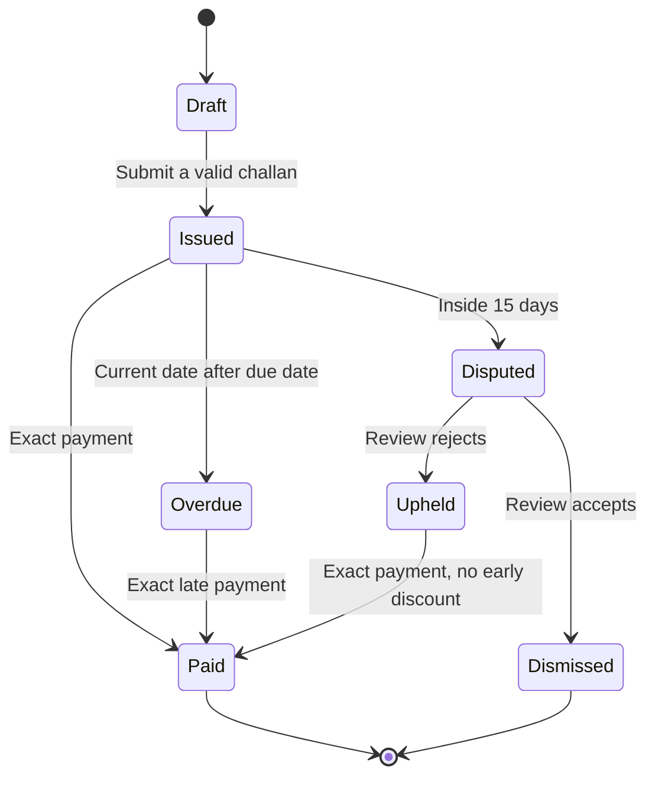

# State Transition — VTFMS

## Technique

State-transition testing checks each allowed move and the moves the requirements forbid. A transition is valid only when it is in the table and any extra guard passes. The dispute window is a guard on Issued → Disputed. The due date is a guard on Issued → Overdue. The exact payable amount is a guard on every move to Paid.

The baseline is `01_Test_Plan/Test_Plan.md`. The standard offence date below is 1 June 2026. A private-car signal jump has calculated fine 1000 and due date 1 July 2026.

## State diagram

## Transition table

| From | To | Guard | Verdict | Case |
| --- | --- | --- | --- | --- |
| Draft | Issued | Challan data is valid | Valid | TC-ST-01 |
| Issued | Paid | Amount equals payable | Valid | TC-ST-02 |
| Issued | Disputed | Offence date through day 15 | Valid | TC-ST-03 |
| Issued | Overdue | Current date after the due date | Valid | TC-ST-04 |
| Overdue | Paid | Amount equals the late payable | Valid | TC-ST-05 |
| Disputed | Dismissed | Review decision | Valid | TC-ST-06 |
| Disputed | Upheld | Review decision | Valid | TC-ST-07 |
| Upheld | Paid | Amount equals payable, no early discount | Valid | TC-ST-08 |
| Paid | Disputed or Paid | None | Invalid | TC-ST-09 |
| Dismissed | Paid | None | Invalid | TC-ST-10 |
| Draft | Paid | None | Invalid | TC-ST-11 |
| Draft | Disputed | None | Invalid | TC-ST-12 |
| Draft | Overdue | None | Invalid | TC-ST-13 |
| Issued | Dismissed | Must pass through Disputed | Invalid | TC-ST-14 |
| Overdue | Disputed | Window has already closed | Invalid | TC-ST-15 |
| Disputed | Paid | Must be Upheld or Dismissed first; Dismissed is not paid | Invalid | TC-ST-16 |
| Issued | Overdue | Current date is the due date | Invalid | TC-ST-17 |

Paid and Dismissed have no outgoing transitions.

## Test cases

| ID | Requirement | Preconditions | Input | Steps | Expected result | Technique | Priority |
| --- | --- | --- | --- | --- | --- | --- | --- |
| TC-ST-01 | REQ-ST-01, REQ-CH-04 | Private car and a valid licence. A draft signal jump exists for 1 Jun 2026 | Submit the draft | 1. Confirm status Draft. 2. Submit. | Status Issued. Fine 1000. Due date 1 Jul 2026. | State transition | High |
| TC-ST-02 | REQ-ST-01, REQ-PAY-02 | Issued signal jump, fine 1000 | Pay on 9 Jun 2026, amount 1000 | 1. Pay. | Status Paid. | State transition | High |
| TC-ST-03 | REQ-ST-01, REQ-DIS-01 | Issued signal jump | Dispute on 1 Jun 2026 | 1. Dispute on the offence date. | Status Disputed. Fine remains 1000. The lower end of the window is accepted. | State transition | High |
| TC-ST-04 | REQ-ST-01, REQ-REP-01 | Issued signal jump, due 1 Jul 2026 | Mark overdue on 2 Jul 2026 | 1. Mark overdue. | Status Overdue. | State transition | High |
| TC-ST-05 | REQ-ST-01, REQ-PAY-03, REQ-PAY-04 | Signal jump marked Overdue on 2 Jul 2026 | First tender 1000, then tender 1250, both on 2 Jul 2026 | 1. Mark overdue. 2. Tender the face fine. 3. Tender 1250. | 1000 is rejected and the status stays Overdue. 1250 is accepted. Status Paid. Amount paid 1250. | State transition | High |
| TC-ST-06 | REQ-DIS-02, REQ-ST-01 | Issued signal jump | Dispute on 1 Jun 2026, decision Dismissed | 1. Dispute. 2. Review as Dismissed. 3. Read the unpaid total. | Status Dismissed. Unpaid total for OWN1 on 1 Jun 2026 is 0. | State transition | High |
| TC-ST-07 | REQ-DIS-02, REQ-ST-01 | Issued signal jump | Dispute on 3 Jun 2026, decision Upheld | 1. Dispute. 2. Review as Upheld. 3. Read the unpaid total. | Status Upheld. Unpaid total is 1000 because the due date has not passed. | State transition | High |
| TC-ST-08 | REQ-ST-01, REQ-PAY-06 | Signal jump reviewed Upheld | Pay on 5 Jun 2026. First 900, then 1000 | 1. Uphold the dispute. 2. Tender 900. 3. Tender 1000. | 900 is rejected. 1000 moves the status to Paid. | State transition | High |
| TC-ST-09 | REQ-ST-01, REQ-PAY-05 | Signal jump already Paid on 9 Jun 2026 | Dispute on 10 Jun 2026, and a second payment of 1000 | 1. Attempt dispute. 2. Attempt a second payment. | Both are rejected. Status stays Paid. | State transition | High |
| TC-ST-10 | REQ-ST-01, REQ-PAY-05 | Signal jump already Dismissed | Pay on 3 Jun 2026, amount 1000 | 1. Attempt payment. | Rejected. Status stays Dismissed. | State transition | High |
| TC-ST-11 | REQ-ST-01 | Draft signal jump, not submitted | Pay on 1 Jun 2026, amount 1000 | 1. Attempt payment. | Rejected. Status stays Draft. | State transition | High |
| TC-ST-12 | REQ-ST-01 | Draft signal jump, not submitted | Dispute on 1 Jun 2026 | 1. Attempt dispute. | Rejected. Status stays Draft. | State transition | High |
| TC-ST-13 | REQ-ST-01 | Draft signal jump, not submitted | Mark overdue on 11 Jul 2026 | 1. Attempt the overdue transition. | Rejected. Status stays Draft. | State transition | High |
| TC-ST-14 | REQ-ST-01 | Issued signal jump | Review decision Dismissed without a dispute | 1. Attempt the review. | Rejected. Status stays Issued. Dismissal is only from Disputed. | State transition | High |
| TC-ST-15 | REQ-ST-01 | Signal jump already Overdue | Dispute on 2 Jul 2026 | 1. Attempt dispute. | Rejected. Status stays Overdue. | State transition | High |
| TC-ST-16 | REQ-ST-01, REQ-PAY-05 | Signal jump Disputed on 2 Jun 2026 | Pay on 3 Jun 2026, amount 900 | 1. Attempt payment. | Rejected. Status stays Disputed. | State transition | High |
| TC-ST-17 | REQ-ST-01 | Issued signal jump, due 1 Jul 2026 | Mark overdue on 1 Jul 2026 | 1. Attempt the overdue transition on the due date. | Rejected. Status stays Issued. The day after the due date is the first overdue day. | State transition | High |
