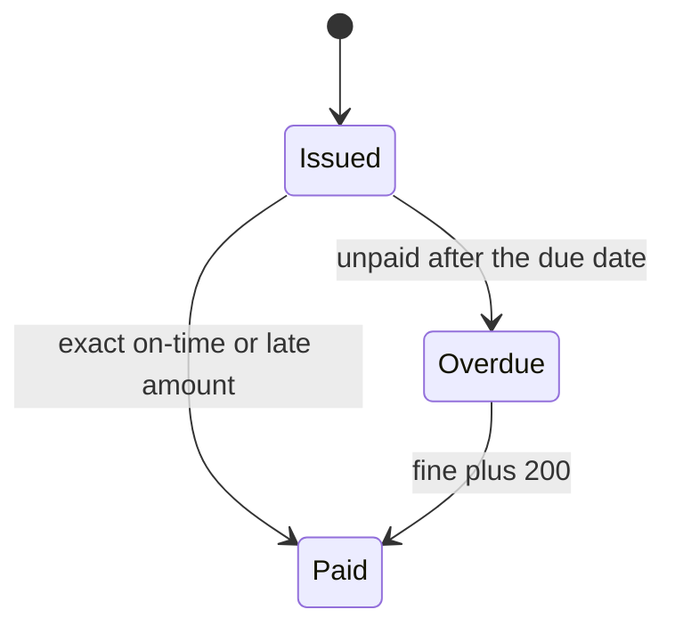

# State Transition

## What to say

A challan starts as Issued. It can then be paid, or it can become Overdue. After it is Overdue, the only move is to pay the late amount. Paid is the end.

Valid moves:

- Issued → Paid, for the exact on-time amount or the exact late amount
- Issued → Overdue, only when the date is after the due date
- Overdue → Paid, for the exact late amount (fine + ₹200)

Invalid moves:

- Paid → Paid (a second payment)
- Overdue → Issued
- Paid → Overdue

The due date in these cases is 16 June 2026, because the challan date is 1 June 2026. Marking a challan Overdue on 16 June is rejected. It is still Issued. TC-ST-02 shows that, and then shows the valid move on 17 June.

## State diagram

## Test cases

The vehicle is a Car. The violation is Signal jump, so the fine is ₹500 and the late amount is ₹700.

| ID | Requirement | Start | Action | Expected result |
| --- | --- | --- | --- | --- |
| TC-ST-01 | REQ-ST-01, REQ-PAY-01 | Issued | Pay ₹500 on 10 June 2026 | Paid |
| TC-ST-02 | REQ-ST-01 | Issued | Mark overdue on 16 June, then on 17 June | 16 June is rejected. Status stays Issued. 17 June moves it to Overdue. |
| TC-ST-03 | REQ-ST-01, REQ-PAY-02 | Overdue | Pay ₹700 on 20 June 2026 | Paid. Amount paid ₹700. Failed on Build B1 (DEF-03). Passes on Build B2. |
| TC-ST-04 | REQ-ST-01, REQ-PAY-03 | Paid | Pay again | Rejected. Status stays Paid. The first amount stays ₹500. |
| TC-ST-05 | REQ-ST-01 | Overdue | Move the challan back to Issued | Rejected. Status stays Overdue. |
| TC-ST-06 | REQ-ST-01 | Paid | Mark overdue | Rejected. Status stays Paid. |

6 cases: TC-ST-01 to TC-ST-06. Three are valid (TC-ST-01, TC-ST-02, TC-ST-03). Three are invalid (TC-ST-04, TC-ST-05, TC-ST-06).
