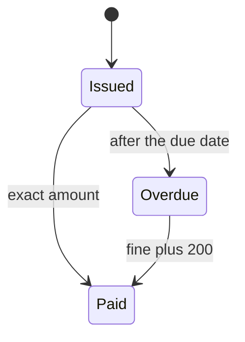
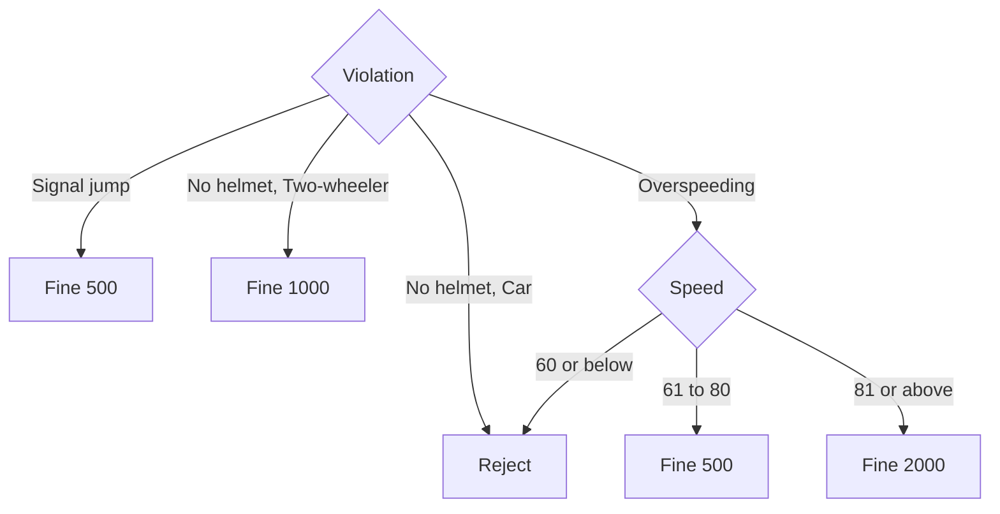

# Diagrams

Three diagrams for the viva. They describe the module in this repository.

## 1. Modules

The officer registers a vehicle, records a challan, and the owner pays one fine.

## 2. Challan states

Issued can become Paid or Overdue. Overdue can become Paid. Paid stops.

## 3. Fine rules

Signal jump is ₹500. No helmet is ₹1000 on a Two-wheeler and is rejected on a Car. Overspeeding uses 60 and 80.

