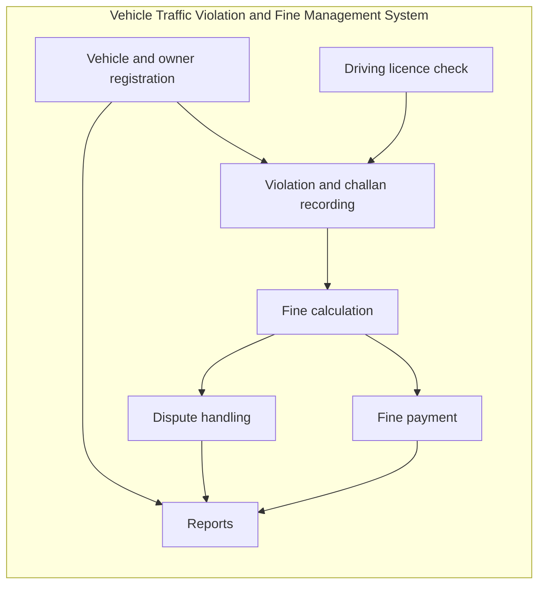
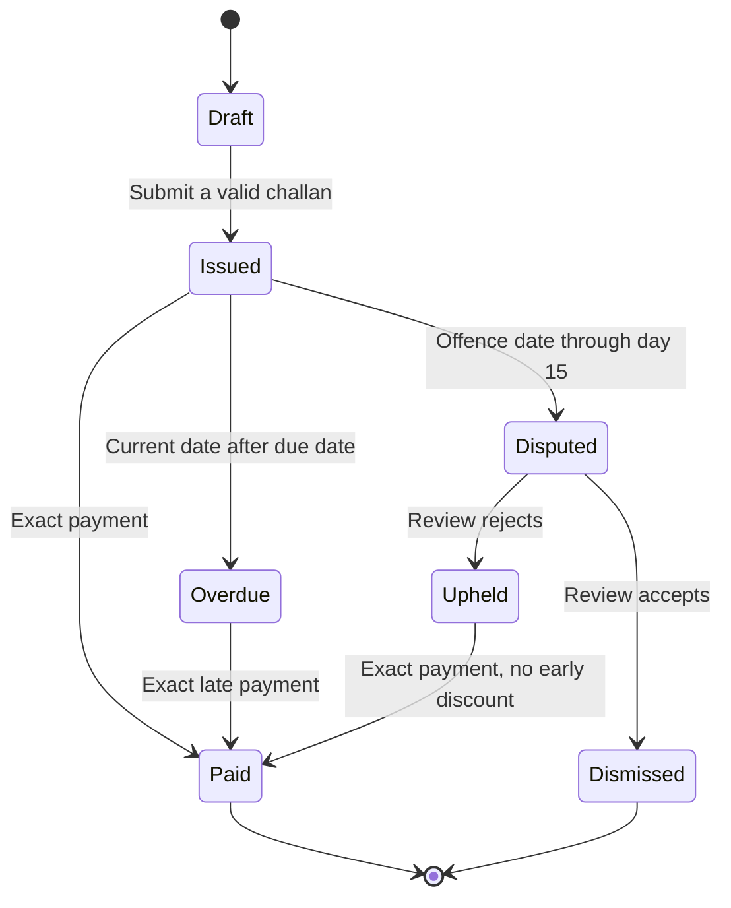
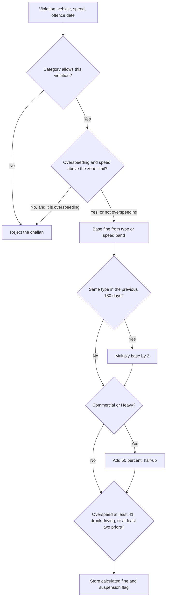
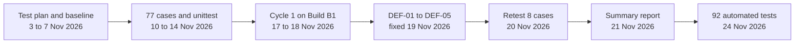

# Diagrams — VTFMS

These diagrams match the requirements baseline and the Python module. They are Mermaid source, not captured screenshots.

## 1. Module diagram

Registration feeds challan recording. The licence check sets `licence_invalid` and does not block the offence. Fine calculation produces the calculated fine and `suspension_recommended`. Payment and disputes change challan state. Reports read registration clearance and the challan list.

## 2. Challan state machine

Rejected moves, with no arrow above: anything leaving Paid or Dismissed; Draft to Paid, Disputed, or Overdue; Issued to Dismissed; Overdue to Disputed; Disputed to Paid. Issued to Overdue is also rejected on the due date itself.

## 3. Fine-calculation flow

The speed flag is set inside the base-fine step when overspeed is 41 or more, and drunk driving sets it as well. The final suspension flag is that value or a prior count of at least 2. A duplicate vehicle, type, and date is rejected before this flow stores a row.

## 4. Test process

Cycle 1 was 69 Pass and 8 Fail. The retest and the later automated run were both fully passing.
